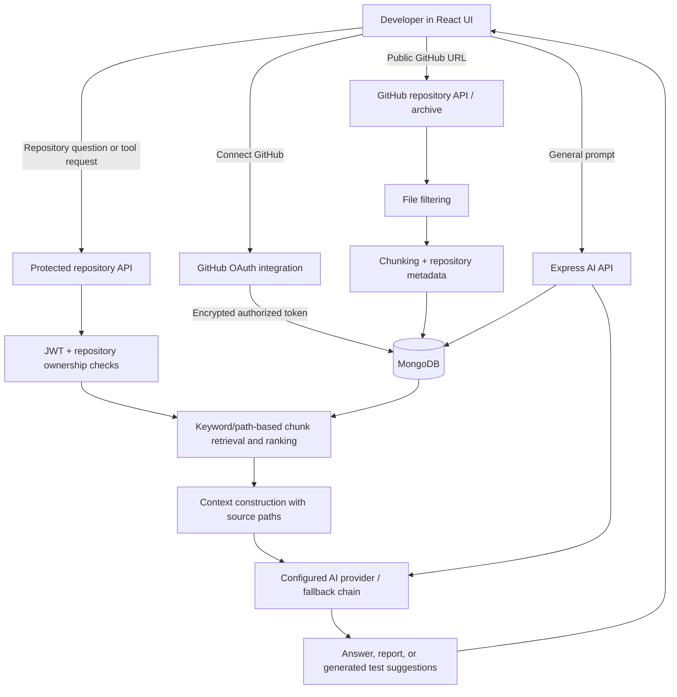

<div align="center">

# AI Developer Toolbox

### An AI workspace for understanding, reviewing, debugging, and exploring GitHub codebases.

**Bring a repository. Ask a question. Investigate the code with evidence.**

[](https://ai-developer-toolbox-c3ud.vercel.app/)
[](https://ai-developer-toolbox-6.onrender.com/)
[](https://github.com/utkarsh-0106/ai-developer-toolbox)

</div>

---

## What is AI Developer Toolbox?

AI Developer Toolbox is a full-stack developer workspace that combines general-purpose AI assistance with **repository-grounded engineering tools**. Instead of asking an AI model to guess how an unfamiliar codebase works, a user can index a GitHub repository and ask questions against the source files selected and stored by the application.

The backend retrieves relevant indexed code, ranks it using lexical and repository-structure signals, and sends the selected context to the configured AI provider. Repository-intelligence responses include source references when available, so developers can trace the explanation back to files in the repository.

### Quick links

| Resource | Link |
|---|---|
| **Live frontend** | [ai-developer-toolbox-c3ud.vercel.app](https://ai-developer-toolbox-c3ud.vercel.app/) |
| **Backend root / API status** | [ai-developer-toolbox-6.onrender.com](https://ai-developer-toolbox-6.onrender.com/) |
| **Backend health check** | [Open `/health`](https://ai-developer-toolbox-6.onrender.com/health) |
| **Source repository** | [GitHub repository](https://github.com/utkarsh-0106/ai-developer-toolbox) |
| **Developer portfolio** | [portfolio-dqyw-opal.vercel.app](https://portfolio-dqyw-opal.vercel.app/) |

> Availability depends on the current deployment and the required environment variables being configured. The GitHub and AI features may be unavailable if their credentials or providers are not configured.

## What can a user do?

### 1. Ask general AI development questions

Use the AI assistant to ask programming and development questions. The API validates the prompt, sends it through the configured AI service, and stores the prompt/response history in MongoDB.

**Example prompts**

- “Explain this JavaScript error and how to fix it.”
- “What is the difference between a process and a thread?”
- “Help me understand this algorithm.”

The quality and availability of answers depend on the selected model/provider and its configuration.

### 2. Index a public GitHub repository

Paste a public repository URL, such as `https://github.com/facebook/react`, into the repository workflow.

The backend can:

1. Validate and resolve the repository URL and metadata.
2. Retrieve the repository archive or tree and identify candidate source files.
3. Filter files to keep relevant code and configuration rather than indiscriminately processing every file.
4. Split selected file contents into manageable chunks.
5. attach repository, branch, commit, file-path, and chunk metadata to the indexed content.
6. Save repository and chunk records in MongoDB for later retrieval.

The indexing pipeline is designed to limit noise and give the AI useful code context. Repository size, supported files, GitHub access, API/network limits, and configured resources can affect what is indexed.

### 3. Connect GitHub and browse authorized repositories

A signed-in user can optionally connect a GitHub account through the GitHub OAuth integration. After a successful connection, the backend can list repositories visible to that account, including private repositories the GitHub authorization permits it to access.

The integration includes:

- Start OAuth authorization.
- Validate a short-lived OAuth state value during the callback.
- Exchange the authorization code for a GitHub token.
- Encrypt the stored token using the configured integration encryption key.
- View connection status and available repositories.
- Disconnect the GitHub integration.

Public repository indexing does not require connecting GitHub. Private repository access requires correct OAuth configuration and permissions. The OAuth callback URL in GitHub settings must exactly match `GITHUB_CALLBACK_URL` on the backend.

### 4. Ask questions about an indexed repository

After a repository has been indexed and is ready, ask natural-language questions about its code. The repository Q&A flow retrieves relevant chunks using the question and indexed source metadata, ranks candidates, builds a context-limited prompt, and asks the configured model to answer from that context.

**Example questions**

- “Where is authentication implemented?”
- “Trace what happens when a request reaches the API.”
- “Which files configure database access?”
- “How does this repository handle errors?”
- “Where should I look to change this behavior?”

The answer is only as reliable as the indexed source and retrieved context. If the relevant implementation was not indexed or retrieved, the model may not have enough evidence to answer fully.

### 5. Explore the indexed repository tree and file contents

Repository-intelligence endpoints let an authenticated user inspect the indexed file and directory structure, open a file from the indexed content, and see metadata such as the indexed commit. This is useful for navigating an unfamiliar codebase without manually searching every file.

### 6. Run repository analysis and engineering workflows

The repository-intelligence API exposes the following tools for a selected, ready repository:

| Tool | What it does | Example use |
|---|---|---|
| **Repository analysis** | Produces a structured overview of architecture, request/data flow, modules, technologies, authentication, storage, AI flow, risks, and improvement ideas from retrieved repository context. | “Help me understand this project before contributing.” |
| **Engineering agent** | Searches relevant chunks, reads selected files, reasons over the evidence, and returns an investigation plus an action plan. | “Trace how login errors move through the backend.” |
| **Code review** | Reviews supplied code with repository context and organizes findings by severity, security, performance, maintainability, and suggested fixes. | “Review this handler for edge cases.” |
| **Debugging investigation** | Uses an error/log and optional code with retrieved repository context to outline evidence, likely causes, fixes, verification, and prevention. | “Why might this API return a 500?” |
| **Security scan** | Examines retrieved source for potential issues involving secrets, authentication, authorization, injection, unsafe configuration, CORS/CSRF/XSS, and data isolation. | “Look for risky authentication patterns.” |
| **Test generation** | Reads a selected indexed file and generates suggested runnable tests and a test plan. | “Generate edge-case tests for this service.” |
| **Diff review** | Reviews a supplied diff for correctness, security, performance, compatibility, missing tests, and architectural concerns. | “Review these proposed changes before merging.” |
| **Repository search** | Searches indexed chunks and ranks matches using terms, source content, file paths, and structural signals. | “Find code related to JWT validation.” |
| **Retrieval telemetry** | Reports retrieval-related information for the selected repository. | “Inspect what the retrieval layer is returning.” |
| **Retrieval evaluation** | Runs retrieval evaluation cases supplied to the endpoint. | “Check whether test questions retrieve useful code context.” |

These are AI-assisted investigation tools, not automatic guarantees that code is correct, secure, or production-ready. Review generated recommendations and run the relevant tests before applying changes.

### 7. Choose an AI provider and configure fallback behavior

The backend AI service supports provider selection through environment configuration:

- **Gemini** — hosted model provider.
- **Groq** — hosted inference provider.
- **OpenAI** — hosted model provider.
- **Ollama** — local model inference, useful for local development.

Set `AI_PROVIDER` to the preferred provider and optionally set `AI_FALLBACK_PROVIDERS` to a comma-separated fallback order. The service attempts configured providers in order and proceeds to the next provider when one is unavailable or fails. A provider must have the relevant credentials/configuration; local Ollama must be reachable from the backend process. A Render-hosted backend cannot reach Ollama running only on your laptop via `localhost`.

### 8. Use Google sign-in for protected workflows

The application includes Google credential verification and JWT-based authorization middleware for protected repository workflows. Users must sign in for protected repository operations. The backend checks repository ownership when reading repository records and chunks, helping prevent one application user from using another user's indexed repository ID to access their data.

The Google OAuth client ID, JWT secret, frontend origin, and backend settings must be configured for the deployed environment.

---

## How the system works



### Request lifecycle for repository Q&A

1. The user signs in and selects an indexed repository.
2. The frontend sends the repository ID and question to the backend.
3. Authentication middleware validates the JWT for protected endpoints.
4. The backend verifies that the repository belongs to the requesting application user and is ready for analysis.
5. The retrieval layer searches chunks associated with that repository and indexed commit, using question terms and source paths/content to rank likely matches.
6. The backend builds a prompt containing the retrieved source snippets and their paths.
7. The configured AI provider generates an answer from the supplied context.
8. The API returns the answer and available source references to the frontend.

### Architecture at a glance

- **Frontend:** React, Vite, React Router, Tailwind CSS, Motion, Google OAuth client integration.
- **Backend:** Node.js, Express, JavaScript ES modules.
- **Persistence:** MongoDB through Mongoose models for users, prompts, repositories, repository chunks, and GitHub integration state.
- **Repository ingestion:** GitHub API/archive retrieval, source-file filtering, chunking, and commit/file metadata.
- **Retrieval:** lexical matching and structural/path ranking over stored repository chunks. The repository-intelligence service describes this as lexical/structural search; it does **not** use a vector database in this workflow.
- **AI layer:** Gemini, Groq, OpenAI, or Ollama selected through environment variables, with an optional ordered fallback list.
- **Hosting configuration:** Vercel frontend, Render backend, MongoDB deployment, and external AI-provider credentials as configured by the operator.

---

## Technology stack

| Layer | Technologies |
|---|---|
| Frontend | React, Vite, React Router, Tailwind CSS, Motion |
| Backend | Node.js, Express.js |
| Database / ODM | MongoDB, Mongoose |
| Identity | Google credential verification, JWT; optional GitHub OAuth integration |
| AI providers | Gemini, Groq, OpenAI, Ollama |
| GitHub ingestion | GitHub API, repository archive/tree processing, file filtering, chunking |
| Testing | Node.js built-in test runner (`node --test`) |
| Deployment | Vercel frontend, Render backend (when configured) |

---

## Getting started locally

### Prerequisites

- Node.js compatible with the installed Vite and backend dependencies.
- npm.
- A reachable MongoDB database.
- A Google OAuth client ID for Google sign-in.
- At least one configured AI provider.
- GitHub OAuth credentials only if you want the connected-account repository workflow.

### 1. Clone the repository

```bash
git clone https://github.com/utkarsh-0106/ai-developer-toolbox.git
cd ai-developer-toolbox
```

### 2. Configure backend environment

Create `backend/.env` using `backend/.env.example` as the reference. The environment loader reads this file relative to the backend source tree.

Example configuration shape (use your own values; never commit secrets):

```dotenv
PORT=5000
NODE_ENV=development
MONGO_URI=mongodb://127.0.0.1:27017/ai-developer-toolbox
FRONTEND_ORIGIN=http://localhost:5173

GOOGLE_CLIENT_ID=your_google_oauth_client_id
JWT_SECRET=replace_with_a_long_random_secret

AI_PROVIDER=gemini
AI_FALLBACK_PROVIDERS=groq
GEMINI_API_KEY=your_gemini_api_key
GEMINI_MODEL=your_supported_gemini_model
GROQ_API_KEY=your_groq_api_key
GROQ_MODEL=your_supported_groq_model
# Optional if using OpenAI:
OPENAI_API_KEY=your_openai_api_key
OPENAI_MODEL=gpt-4.1-mini
# Optional local provider:
OLLAMA_BASE_URL=http://localhost:11434
OLLAMA_MODEL=qwen3:8b

# Only needed for GitHub account connection:
GITHUB_CLIENT_ID=your_github_oauth_client_id
GITHUB_CLIENT_SECRET=your_github_oauth_client_secret
GITHUB_CALLBACK_URL=http://localhost:5000/api/integrations/github/callback
INTEGRATION_ENCRYPTION_KEY=your_application_encryption_key
```

Use model names supported by the provider account and current provider API. Configure at least one provider correctly. Do not commit `backend/.env` or paste secret values into issues, screenshots, or chat.

### 3. Install dependencies and start the backend

```bash
cd backend
npm ci
npm run dev
```

The backend defaults to port `5000`. It connects to MongoDB before accepting requests.

### 4. Install dependencies and start the frontend

Open a second terminal from the project root:

```bash
cd frontend
npm ci
npm run dev
```

Vite normally serves the frontend at `http://localhost:5173`.

If the frontend has an API-base-URL setting, point it at `http://localhost:5000` for local development. The deployed frontend must point to the deployed backend instead.

### 5. Verify the backend

```bash
curl http://localhost:5000/
curl http://localhost:5000/health
```

The root endpoint returns a short API-running message. `/health` returns a JSON status payload.

---

## Environment variable reference

| Variable | Purpose | Required when |
|---|---|---|
| `PORT` | Backend listening port; hosting platforms may supply this automatically. | Local/deployed server configuration |
| `NODE_ENV` | Runtime environment label. | Recommended |
| `MONGO_URI` | MongoDB connection string. | Always for normal application startup |
| `FRONTEND_ORIGIN` | Comma-separated frontend origin allowlist for CORS and OAuth redirect destination. | Local/deployed frontend access |
| `GOOGLE_CLIENT_ID` | Verifies Google sign-in credentials. | Google sign-in |
| `JWT_SECRET` | Signs/verifies application JWTs. Use a strong private value. | Protected routes |
| `AI_PROVIDER` | Primary provider: `gemini`, `groq`, `openai`, or `ollama`. | AI functionality |
| `AI_FALLBACK_PROVIDERS` | Optional comma-separated fallback provider order. | Optional reliability behavior |
| `GEMINI_API_KEY`, `GEMINI_MODEL` | Gemini credentials and model configuration. | When Gemini is used |
| `GROQ_API_KEY`, `GROQ_MODEL` | Groq credentials and model configuration. | When Groq is used |
| `OPENAI_API_KEY`, `OPENAI_MODEL` | OpenAI credentials and model configuration. | When OpenAI is used |
| `OLLAMA_BASE_URL`, `OLLAMA_MODEL` | Ollama server address and local model name. | When Ollama is used |
| `GITHUB_CLIENT_ID`, `GITHUB_CLIENT_SECRET` | GitHub OAuth app credentials. | Connected GitHub account workflow |
| `GITHUB_CALLBACK_URL` | Exact callback URL registered in the GitHub OAuth app. | Connected GitHub account workflow |
| `INTEGRATION_ENCRYPTION_KEY` | Key used by the integration secret-encryption service to protect stored GitHub tokens. | Connected GitHub account workflow |

Do not expose private keys or provider secrets through frontend `VITE_` variables. Frontend environment variables are bundled into browser assets and must be treated as public.

### GitHub OAuth callback URLs

For local development, the callback route is:

`http://localhost:5000/api/integrations/github/callback`

For the deployed backend, the expected route is:

`https://ai-developer-toolbox-6.onrender.com/api/integrations/github/callback`

Register the exact URL that matches the environment being used in the GitHub OAuth application. The callback route is mounted under `/api/integrations` in the Express server.

---

## API overview

The following routes are mounted by the backend. Protected routes require the application's authorization middleware/JWT as shown by the route definitions.

| Method | Route | Purpose | Auth |
|---|---|---|---|
| `GET` | `/` | API-running message | No |
| `GET` | `/health` | Health/status payload | No |
| `POST` | `/api/ai/ask` | Generate a general AI response from a prompt | Route does not add JWT middleware |
| `GET` | `/api/ai/history` | Retrieve recent prompt/response history | Route does not add JWT middleware |
| `DELETE` | `/api/ai/history/:id` | Delete a prompt history item by ID | Route does not add JWT middleware |
| `POST` | `/api/auth/google` | Verify a Google credential and return authentication result | Credential-based sign-in |
| `POST` | `/api/github/public/repository` | Resolve public repository metadata | No route-level JWT middleware |
| `POST` | `/api/github/index` | Index a public repository for the authenticated user | Yes |
| `POST` | `/api/github/index-connected` | Index a repository using the connected GitHub account | Yes |
| `POST` | `/api/repository/qa` | Ask a question about an indexed repository | Yes |
| `POST` | `/api/integrations/github/start` | Start GitHub OAuth | Yes |
| `GET` | `/api/integrations/github/callback` | Handle GitHub OAuth callback | OAuth state/code flow |
| `GET` | `/api/integrations/github/status` | Check connection status | Yes |
| `GET` | `/api/integrations/github/repositories` | List repositories available to connected GitHub account | Yes |
| `DELETE` | `/api/integrations/github` | Disconnect GitHub | Yes |
| `GET` | `/api/repository-intelligence/:repositoryId/tree` | Get indexed file/directory tree | Yes |
| `GET` | `/api/repository-intelligence/:repositoryId/file?path=...` | Read an indexed file | Yes |
| `POST` | `/api/repository-intelligence/:repositoryId/analyze` | Analyze repository architecture | Yes |
| `POST` | `/api/repository-intelligence/:repositoryId/agent` | Run evidence-based repository investigation | Yes |
| `POST` | `/api/repository-intelligence/:repositoryId/review` | Review submitted code | Yes |
| `POST` | `/api/repository-intelligence/:repositoryId/debug` | Investigate an error and optional code | Yes |
| `POST` | `/api/repository-intelligence/:repositoryId/security` | Generate a source-informed security report | Yes |
| `POST` | `/api/repository-intelligence/:repositoryId/tests` | Generate tests for an indexed file | Yes |
| `POST` | `/api/repository-intelligence/:repositoryId/diff-review` | Review a submitted diff | Yes |
| `POST` | `/api/repository-intelligence/:repositoryId/search` | Search and rank indexed source chunks | Yes |
| `GET` | `/api/repository-intelligence/:repositoryId/telemetry` | Retrieve retrieval telemetry | Yes |
| `POST` | `/api/repository-intelligence/:repositoryId/evaluate` | Evaluate retrieval using supplied cases | Yes |

The exact request bodies and response schemas should be checked in the corresponding route/controller files before building a client integration. API availability also depends on the backend configuration and repository state.

---

## Scripts and checks

### Backend

```bash
cd backend
npm test
npm run dev
npm start
```

- `npm test` runs Node's built-in test runner.
- `npm run dev` starts the server with Nodemon.
- `npm start` starts the server with Node.js.

### Frontend

```bash
cd frontend
npm run dev
npm run build
npm run lint
npm run preview
```

- `npm run dev` starts Vite development server.
- `npm run build` creates a production build.
- `npm run lint` runs ESLint.
- `npm run preview` serves the production build locally.

Run tests/builds in your environment before publishing changes; this README does not imply that a test or deployment check was run as part of documentation generation.

---

## Deployment overview

### Frontend — Vercel

1. Import the GitHub repository into Vercel and select the `frontend` directory as the project root if deploying from the monorepo layout.
2. Set the frontend API base URL to the Render backend URL using the environment-variable name the frontend code reads.
3. Deploy and verify the site can reach the backend.

### Backend — Render

1. Create a Node web service from the repository and configure the backend directory/build/start commands for this project layout.
2. Set `MONGO_URI`, `FRONTEND_ORIGIN`, `JWT_SECRET`, Google OAuth settings, and the AI provider variables in Render's Environment settings.
3. Add GitHub OAuth variables only if the connected-account workflow is needed.
4. Register the exact Render callback URL in the GitHub OAuth app.
5. Deploy and verify `/` and `/health`.

### Database — MongoDB

Provision a MongoDB database, configure its connection string as `MONGO_URI`, and ensure the database network/access rules permit the backend to connect. Keep credentials in deployment environment settings, not in the repository.

### Deployment checklist

- [ ] Frontend API base URL points to the intended backend.
- [ ] `FRONTEND_ORIGIN` exactly matches the deployed frontend origin.
- [ ] MongoDB connection succeeds.
- [ ] At least one AI provider is configured and reachable.
- [ ] Google sign-in is configured with the correct client ID and allowed origins.
- [ ] If using GitHub OAuth, callback URL, client ID, client secret, and encryption key all match the same environment.
- [ ] Backend health endpoint responds successfully.
- [ ] No `.env` files or credentials are committed.

---

## Security and limitations

- Keep all AI provider keys, JWT secrets, GitHub OAuth secrets, and database credentials on the backend.
- Use HTTPS in production and configure CORS with the intended frontend origins.
- Protected repository endpoints use JWT middleware and repository ownership checks.
- GitHub OAuth uses state validation and the integration service encrypts stored access tokens. Treat OAuth credentials and the encryption key as sensitive production secrets.
- AI-generated code reviews, security findings, debugging suggestions, and tests are advisory. Validate them against source, tests, and your own security review.
- Retrieval works over indexed files and chunks. Missing files, stale indexing, file filters, retrieval ranking, and model context limits can affect answers.
- GitHub API permissions/rate limits, provider quotas, network failures, MongoDB availability, and hosting cold starts can affect the experience.
- WhatsApp integration is **not included** in this version of the project.

---

## Repository structure

```text
ai-developer-toolbox/
├── backend/
│   ├── src/
│   │   ├── config/          # Environment and database configuration
│   │   ├── controllers/     # HTTP request handlers
│   │   ├── middleware/      # Authentication/authorization middleware
│   │   ├── models/          # Mongoose models
│   │   ├── routes/          # Express route definitions
│   │   └── services/        # AI, GitHub ingestion, retrieval and analysis logic
│   ├── .env.example         # Environment variable template
│   └── package.json
├── frontend/
│   ├── src/                 # React application source
│   └── package.json
├── INTEGRATIONS_SETUP.md    # Optional GitHub integration setup
└── README.md
```

Some files may vary as the project evolves. The directory names above describe the main architectural areas, not every file.

---

## Contributing

1. Fork the repository and create a focused branch.
2. Keep changes aligned with the existing React/Express architecture.
3. Add or update tests for changed behavior.
4. Run backend tests, frontend lint, and frontend production build.
5. Never include credentials, local `.env` files, `node_modules`, or build output in commits.
6. Open a pull request with a clear description of the behavior changed and checks performed.

## Author

**Utkarsh Maheshwari**

- [GitHub](https://github.com/utkarsh-0106)
- [Portfolio](https://portfolio-dqyw-opal.vercel.app/)
- [Project repository](https://github.com/utkarsh-0106/ai-developer-toolbox)

---

<div align="center">

Built to make unfamiliar codebases easier to explore, understand, and improve.

</div>
